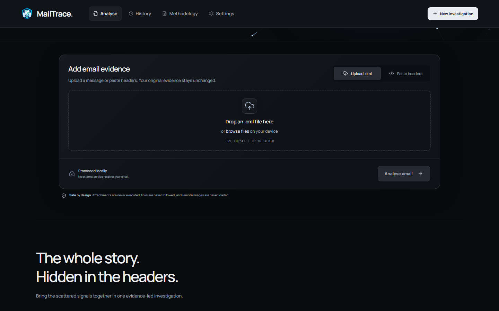
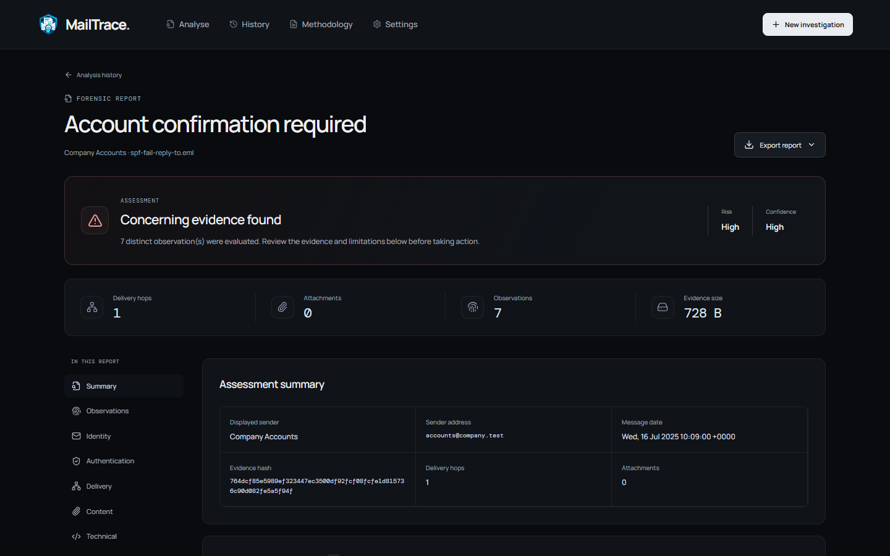
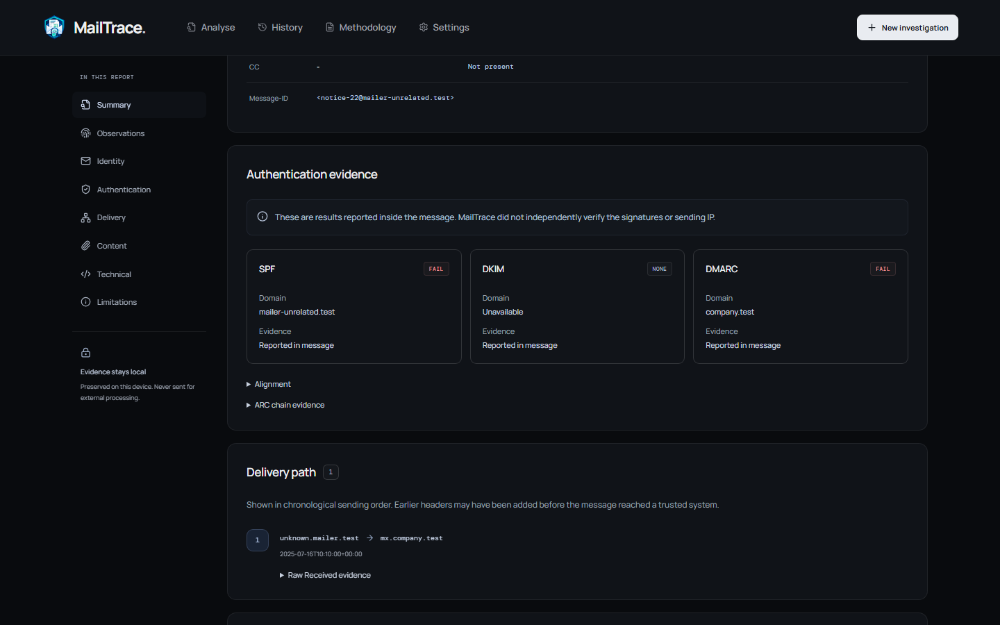
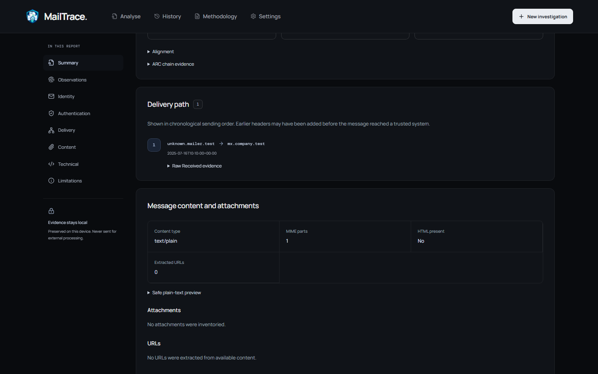
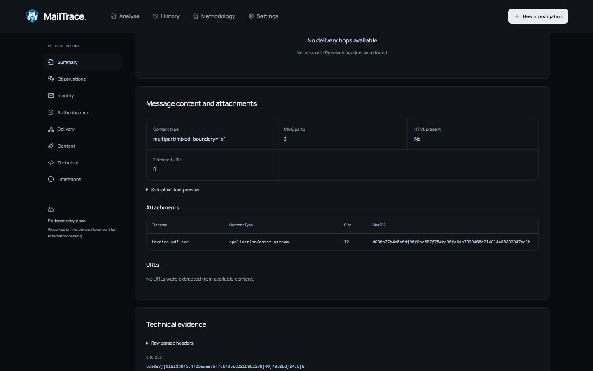
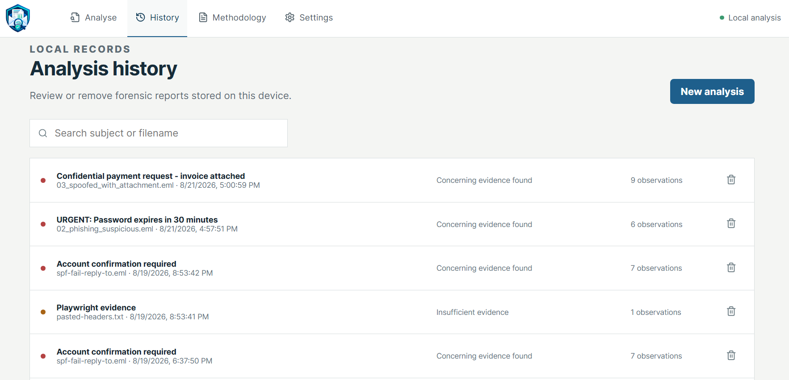

# MailTrace

**Local-first email forensic triage for turning raw message evidence into an explainable investigation report.**

[](https://github.com/mosaddiqurr/MailTrace/actions/workflows/validate.yml)
[](pyproject.toml)
[](LICENSE)

MailTrace helps analysts examine `.eml` files and pasted email headers without sending message evidence to an external service. It organizes delivery, identity, authentication, MIME, URL, and attachment evidence while keeping the underlying facts and limitations visible.

## Key capabilities

- Analyze `.eml` files and raw email headers.
- Investigate reported SPF, DKIM, DMARC, ARC, and sender identity alignment.
- Reconstruct delivery paths and inspect extracted URLs and attachments.
- Export evidence-led reports in PDF, JSON, CSV, text, HTML, and ZIP formats.

MailTrace treats authentication headers as receiver-reported evidence. It does **not** perform fresh DKIM cryptographic verification, reconstruct historical DNS, execute or malware-scan attachments, reputation-check URLs, or make definitive malicious/benign classifications.

## Interface walkthrough

The screens below use synthetic email evidence and show the local investigation workflow from intake through retained analysis history.

### Analysis input



Upload a synthetic `.eml` file or paste raw headers for processing on the local device.

### Investigation overview



Review the assessment, confidence, evidence summary, and strongest observations without reducing the message to a definitive malicious/benign verdict.

### Authentication analysis



Inspect receiver-reported SPF, DKIM, and DMARC results alongside an explicit verification disclaimer and expandable alignment and ARC context.

### Delivery path



Follow chronologically ordered `Received` hops while retaining access to the raw header evidence and its trust-boundary caveat.

### Message content and attachments



Review MIME structure, a non-rendered plain-text preview, attachment metadata, and SHA-256 evidence without executing the attachment or rendering active HTML.

### Local analysis history



Search, reopen, or delete forensic reports retained on the local device.

## Capabilities

- Parses bounded RFC email headers and MIME structures without rendering active HTML or executing attachments.
- Reconstructs `Received` hops, timestamps, and IP classifications.
- Extracts reported SPF, DKIM, DMARC, and ARC evidence and explains identity alignment.
- Inventories attachments and URLs, including hashes and display-versus-destination differences.
- Stores analyses locally and exports PDF, JSON, CSV, plain text, HTML, and ZIP bundles.
- Provides responsive React workflows for upload, pasted headers, history, settings, and deletion.

MailTrace distinguishes facts, reported authentication claims, derived comparisons, and contextual observations. Authentication headers describe what a receiving system reported; MailTrace does not freshly verify DKIM signatures, reproduce historical DNS, or prove that a message is safe or malicious.

## Architecture

The frontend uses React, TypeScript, Vite, and TanStack Query. FastAPI provides the API and production static hosting, with SQLAlchemy and SQLite for local persistence and Alembic for migrations. Parsed analyses and retained originals stay in the local `data/` directory by default. Optional current-DNS enrichment is disabled until explicitly enabled.

See the [architecture and local data-flow diagram](docs/ARCHITECTURE.md) for component boundaries, evidence storage, report generation, and the only optional network path.

Pytest, Vitest, ESLint, MyPy, Ruff, and Playwright cover the backend, frontend, and real-browser workflow.

## Run from a fresh clone

Requirements: Python 3.12+, Node.js 24+, npm, and Windows PowerShell.

For the production-style local application:

```powershell
powershell -ExecutionPolicy Bypass -File .\scripts\run-local.ps1
```

The script creates `.venv` when missing, installs Python dependencies, applies Alembic migrations, builds the frontend when needed, and serves MailTrace at `http://127.0.0.1:8000`. Keep that terminal open; press Ctrl+C to stop.

For frontend development with hot reload:

```powershell
Set-Location .\frontend
npm.cmd ci
Set-Location ..
powershell -ExecutionPolicy Bypass -File .\scripts\run-local.ps1 -Development
```

Open `http://127.0.0.1:5173`. Vite proxies `/api` to the FastAPI server on port 8000.

To install or migrate manually:

```powershell
python -m venv .venv
.\.venv\Scripts\python.exe -m pip install -e ".[dev]"
Set-Location .\frontend
npm.cmd ci
npm.cmd run build
Set-Location ..
.\.venv\Scripts\python.exe -m alembic upgrade head
```

Runtime data defaults to `data/`. It is intentionally Git-ignored because it can contain private evidence. Configuration uses `MAILTRACE_` environment variables; see [`mailtrace/config.py`](mailtrace/config.py) for available limits and paths.

## Demo data

Synthetic examples are packaged under [`mailtrace/fixtures/`](mailtrace/fixtures/). Start with `aligned-business.eml` for a low-concern message and `spf-fail-reply-to.eml` for reported authentication failure and sender-identity differences. The application also exposes these through its demo API. No real email evidence belongs in fixtures.

## Validation

Run the complete local validation sequence:

```powershell
powershell -ExecutionPolicy Bypass -File .\scripts\validate.ps1
```

Useful individual commands:

```powershell
.\.venv\Scripts\python.exe -m ruff check mailtrace tests alembic scripts
.\.venv\Scripts\python.exe -m mypy mailtrace tests
.\.venv\Scripts\python.exe -m pytest --cov=mailtrace --cov-branch
Set-Location .\frontend
npm.cmd run lint
npm.cmd run test
npm.cmd run build
npm.cmd run test:e2e
npm.cmd audit --audit-level=high
```

`npm run test:e2e` owns its temporary Uvicorn process, waits for readiness, and releases port 8000 after the run. The [recorded release validation](docs/VALIDATION.md) documents the validated toolchain and results.

## Security, privacy, and limitations

Message processing is local by default. MailTrace does not load remote images, follow links, execute attachments, or render active message HTML. Input sizes, header counts, MIME depth, part counts, attachment counts, decoded bytes, URL counts, and processing time are bounded. Optional current-DNS enrichment is disabled until the user enables it; enabling it makes network DNS requests.

Header evidence can be forged before a trusted receiving boundary. Current DNS cannot reconstruct historical authentication state. Static attachment inspection is not malware analysis, and URL extraction is not reputation checking. See the [documentation index](docs/README.md) for the detailed methodology, architecture, security model, privacy notes, retention behavior, exports, testing, and limitations.

Docker configuration is included in [`Dockerfile`](Dockerfile) and [`compose.yaml`](compose.yaml).

## License

MailTrace is available under the [MIT License](LICENSE).
