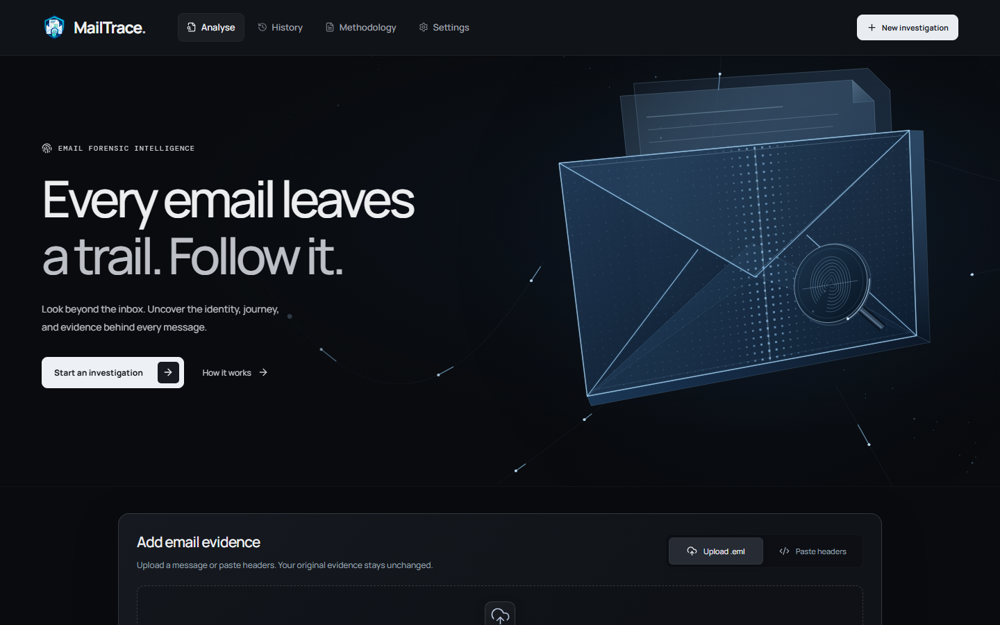

# MailTrace

**Every email leaves a trail. Follow it.**

[](https://github.com/mosaddiqurr/MailTrace/actions/workflows/validate.yml)
[](pyproject.toml)
[](frontend/package.json)
[](LICENSE)

MailTrace is a local-first email forensics application. Upload an `.eml` file or paste raw headers to investigate sender identity, reported authentication, delivery routes, message content, attachments, and URLs. Review the evidence in an explainable report while keeping the original message on your device.



## What you can investigate

- **Identity and authentication:** compare sender, reply, and envelope identities with receiver-reported SPF, DKIM, DMARC, and ARC evidence.
- **Delivery:** reconstruct ordered `Received` hops, timestamps, and IP classifications, with access to the raw headers.
- **Content:** inspect MIME structure, attachment metadata, SHA-256 hashes, and extracted URLs without executing files or loading remote content.
- **History:** search, reopen, and delete analyses stored locally, with configurable evidence retention.
- **Reports:** export PDF, JSON, CSV, text, HTML, and ZIP evidence bundles.

MailTrace separates direct facts, reported authentication claims, derived comparisons, and contextual observations. It does not freshly verify DKIM signatures, reconstruct historical DNS, malware-scan attachments, reputation-check URLs, or guarantee that a message is safe or malicious.

## Interface and performance

The responsive dark interface connects a compact upload workspace with structured reports, history, methodology, and settings. The original animated email sculpture uses a browser worker through OffscreenCanvas where supported. Its cached geometry, batched particles, bounded resolution, and automatic off-screen suspension keep drawing separate from input handling. Older browsers use an optimized canvas fallback. Fonts and visual assets are served locally.

The recorded clean desktop Lighthouse run scored **100 Performance, 100 Accessibility, 100 Best Practices, and 100 SEO**, with a **0.6 s Largest Contentful Paint** and **0 ms Total Blocking Time**. A separate 4× CPU slowdown test reduced the sampled 95th-percentile input response from 544 ms to 64 ms. These are local measurements, not guarantees for every device; see the [performance report](docs/PERFORMANCE.md) for settings, comparisons, and limits.

The latest interface checks passed **19 unit tests and 23 desktop/mobile browser checks**, with one intentional desktop skip for a mobile-only test. Accessibility scores describe automated checks, not a complete accessibility certification.

## Investigation walkthrough


Review the assessment and its basis, then inspect identity, authentication, delivery, content, technical evidence, and limitations. Every screenshot uses the packaged synthetic fixtures.

<details>
<summary>See the evidence workspace and detailed report sections</summary>

### Add evidence


### Authentication evidence


### Delivery path


### Content and attachments


</details>


## Run locally

Requirements: **Python 3.12+**, **Node.js 24+**, npm, and Windows PowerShell. From a fresh clone:

```powershell
git clone https://github.com/mosaddiqurr/MailTrace.git
Set-Location MailTrace
powershell -ExecutionPolicy Bypass -File .\scripts\run-local.ps1
```

Open **http://127.0.0.1:8000**. The launcher creates `.venv` if missing, installs Python dependencies, applies migrations, builds a missing frontend, and starts FastAPI. Keep the terminal open; press Ctrl+C to stop.

For frontend development with hot reload:

```powershell
npm.cmd ci --prefix frontend
powershell -ExecutionPolicy Bypass -File .\scripts\run-local.ps1 -Development
```

Open **http://127.0.0.1:5173**. Vite proxies `/api` to port 8000.

After pulling a newer version, rebuild an existing frontend before restarting the production-style app:

```powershell
git pull --ff-only
.\.venv\Scripts\python.exe -m pip install -e ".[dev]"
npm.cmd ci --prefix frontend
npm.cmd run build --prefix frontend
powershell -ExecutionPolicy Bypass -File .\scripts\run-local.ps1
```

See [local setup](docs/RUN_LOCAL.md) for manual startup, configuration, and first-run browser installation. Docker configuration is included in [Dockerfile](Dockerfile) and [compose.yaml](compose.yaml).

## Synthetic demo evidence

Start with [`aligned-business.eml`](mailtrace/fixtures/aligned-business.eml) for a routine message, [`spf-fail-reply-to.eml`](mailtrace/fixtures/spf-fail-reply-to.eml) for sender and authentication differences, and [`double-extension.eml`](mailtrace/fixtures/double-extension.eml) for static attachment inspection. The [demo guide](docs/DEMO_GUIDE.md) walks through the workflow. The demo API remains available; no real message evidence belongs in the fixture corpus.

## Architecture

React, TypeScript, Vite, React Router, and TanStack Query provide the UI. FastAPI serves the APIs and production frontend. SQLAlchemy and SQLite store analyses locally, and Alembic manages migrations. Reports use the same persisted evidence as the UI. The canvas worker receives only rendering and visibility information, never email evidence.

See the [architecture diagram](docs/ARCHITECTURE.md), [interface design](docs/UI_DESIGN.md), and [documentation index](docs/README.md).

## Validate and maintain

Install Chromium once before the first real-browser run:

```powershell
Set-Location frontend
npx.cmd playwright install chromium
Set-Location ..
powershell -ExecutionPolicy Bypass -File .\scripts\validate.ps1
```

The validation script checks Ruff, formatting, strict MyPy, backend tests and coverage, ESLint, frontend tests and coverage, the production build, dependency auditing, and Playwright. Stop any application on port 8000 first: the browser suite starts its own server with isolated temporary data and refuses to reuse a running instance.

GitHub Actions runs backend checks on Linux and Windows, plus frontend checks and the real-browser suite on Linux. See [testing](docs/TESTING.md) and the dated [validation records](docs/VALIDATION.md).

Regenerate the seven README screenshots with `npm run docs:screenshots --prefix frontend`. This starts an isolated temporary server and loads only synthetic fixtures; see the [screenshot guide](docs/screenshots/README.md).

## Privacy and limitations

Evidence defaults to the Git-ignored `data/` directory. MailTrace does not follow extracted links, load remote images, execute attachments, or render active message HTML. Parsing and processing are bounded. Optional current-DNS enrichment is disabled by default and makes network DNS requests only when explicitly enabled.

Headers can be forged before a trusted receiving boundary. Current DNS is not historical authentication proof. Read the [security model](docs/SECURITY.md), [privacy notes](docs/PRIVACY.md), [retention behavior](docs/DATA_RETENTION.md), and [analysis limitations](docs/LIMITATIONS.md) before interpreting findings.

Generated builds, dependencies, caches, logs, browser reports, local evidence, and working notes are excluded from Git. The repository retains the source, fixture corpus, tests, migrations, operating scripts, documentation, and design assets needed to maintain the application.

## License

[MIT](LICENSE).
