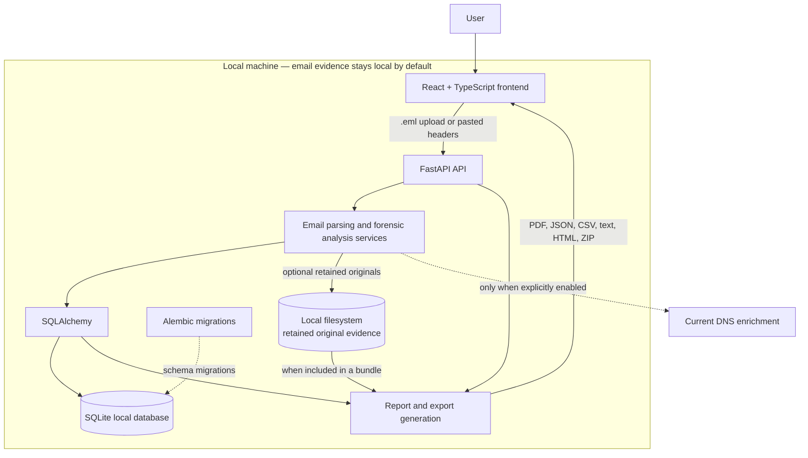

# Architecture

The React/TypeScript client uses the `/api/analyses` workflow and is served by Vite during development or FastAPI from `frontend/dist` in production. FastAPI validates input, invokes the bounded Python email parser, persists one evidence analysis inside an automatically created compatible case, and returns structured JSON. SQLAlchemy targets local SQLite; Alembic owns migrations. Original bytes are stored separately under generated identifiers.

The parser separates direct headers, receiver-reported authentication, derived alignment/hop data, heuristic observations, assessment, and limitations. Reports are generated from the same persisted result used by the UI.

## Local-first data flow

The dotted DNS path is the only analysis-related network path and is disabled by default. It provides current context, not historical DNS reconstruction or fresh authentication verification. SQLite records and retained originals default to the Git-ignored `data/` directory. Exports are generated on demand from the persisted analysis and, for bundles, any retained original evidence.
